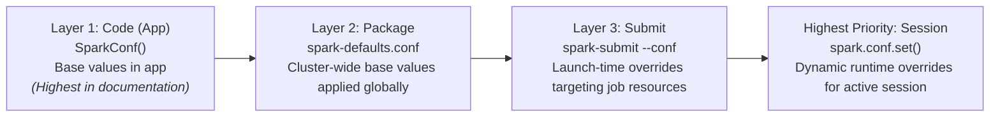
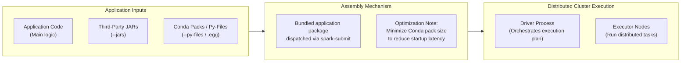
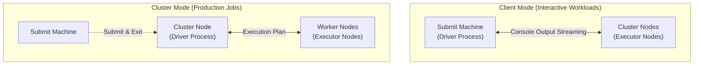
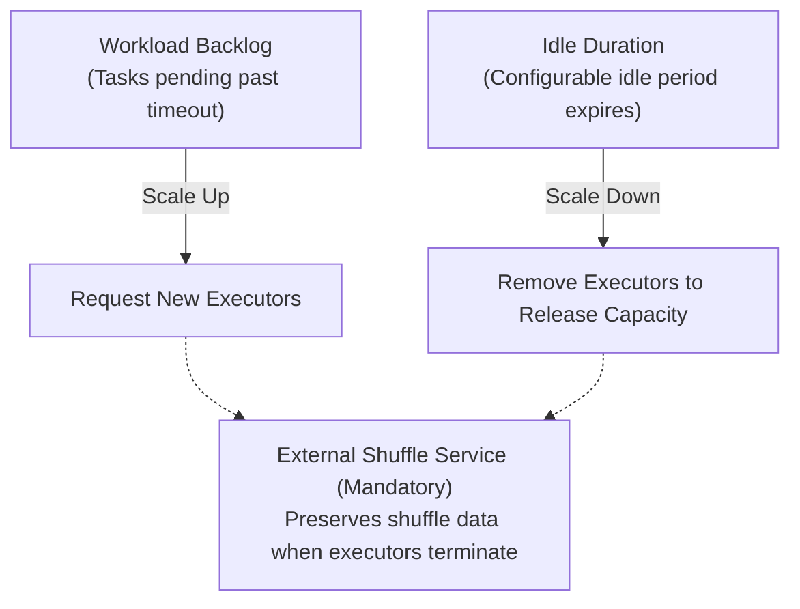
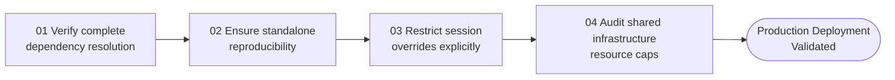

# Apache Spark Configuration

## Slide 1: Big Data Analysis Architecture

**Category:** BIG DATA ANALYSIS ARCHITECTURE

# Apache Spark Configuration

Framework dependencies, cluster deployment models, and session-level tuning for production readiness.

---

## Slide 2: Reproducible Environments

**Category:** SYSTEM DESIGN

### Reproducible Environments

**The same code can behave entirely differently across execution layers.**

- **Exact configuration parity**  
  Crucial for expected behavior across dev, test, and prod. Troubleshooting Docs,
- **Missing dependencies**  
  The leading cause of cluster failure vs. local success. Importance of JARs, Libraries, Paths...
- **Global vs. Overrides**  
  Keep environment defaults strictly isolated from job overrides. Prevent ad-hoc workload tuning from polluting the global state, ensuring reproducibility.

*(Visual: Workstation laboratory setting; Credit: gorodenkoff / iStock)*

---

## Slide 3: Configuration Precedence

**Category:** HIERARCHY

### Configuration Precedence

Four core mechanisms for managing Apache Spark environments



```
Configuration Precedence Hierarchy (Low to High Override Priority):
├── Layer 1: Code (App)
│   ├── Property Mechanism: SparkConf()
│   ├── Scope: Base values hardcoded within the source application
│   └── Note: In documentation it should be the highest
├── Layer 2: Package
│   ├── Property Mechanism: spark-defaults.conf
│   └── Scope: Cluster-wide base values applied globally to the environment
├── Layer 3: Submit
│   ├── Property Mechanism: spark-submit --conf
│   └── Scope: Launch-time overrides targeting job-specific execution resources
└── Highest Priority: Session
    ├── Property Mechanism: spark.conf.set()
    └── Scope: Dynamic runtime overrides for the active execution session
```

| Precedence Layer | Scope / Mechanism | Target / Command | Description | Note |
| :--- | :--- | :--- | :--- | :--- |
| **LAYER 1** | **Code (App)** | `SparkConf()` | Base values hardcoded within the source application. | *In documentation it should be the highest.* |
| **LAYER 2** | **Package** | `spark-defaults.conf` | Cluster-wide base values applied globally to the environment. | |
| **LAYER 3** | **Submit** | `spark-submit --conf` | Launch-time overrides targeting job-specific execution resources. | |
| **HIGHEST PRIORITY** | **Session** | `spark.conf.set()` | Dynamic runtime overrides for the active execution session. | |

---

## Slide 4: Dependency Packaging Flow

**Category:** DISTRIBUTION

### Dependency Packaging Flow

illustrates how a Spark application transitions from local code into a fully distributed cluster execution



```
Application Submission Pipeline:
├── 1. Application Inputs
│   ├── Application Code (Main logic)
│   ├── Third-Party JARs (--jars)
│   └── Conda Packs / Py-Files (--py-files / .egg)
│
├── 2. Assembly Mechanism
│   ├── Bundled application package dispatched via spark-submit
│   └── Optimization Note: Minimize Conda pack size to reduce startup latency
│
└── 3. Distributed Cluster Execution
    ├── Driver Process (orchestrates execution plan)
    └── Executor Nodes (run distributed tasks)
```

- **Application Inputs Summary:** gathering the essential application inputs third-party JARs supplied via the `--jars` flag, and Python dependencies structured as Conda packs or Py-files using `--py-files` or `.egg` extensions.
- **Assembly Mechanism Summary:** Bundled application package dispatched via `spark-submit`.
- **Optimization Note:** Minimize Conda pack size to reduce startup latency.
- **Execution Distribution Summary:** Once successfully deployed, the packaged environment is distributed to the driver process—which orchestrates the execution plan—and to the executor nodes, where the distributed tasks are actively run.

---

## Slide 5: Deploy Modes

**Category:** ARCHITECTURE

### Deploy Modes

Place the driver process where the workload needs it most.



```
Deploy Modes Comparison:
├── Client Mode
│   ├── Driver Location: Submit machine
│   ├── Workload Focus: Interactive Workloads (notebooks, REPL sessions)
│   ├── Visibility: Immediate Visibility (console output streams directly to user)
│   ├── Operational Risk: Network Vulnerability (job fails if local machine disconnects)
│   └── Summary: In Client Mode, the driver runs directly on the submit machine, which provides immediate visibility by streaming console output directly back to the user.
│
└── Cluster Mode
    ├── Driver Location: Isolated cluster node
    ├── Workload Focus: Production Jobs (long-running ETL workflows)
    ├── Resilience: High Resilience (unaffected by submitter network drops)
    ├── Operational Lifecycle: Fire-and-Forget (submit process can safely exit post-launch)
    └── Summary: Cluster Mode resolves this vulnerability by running the driver inside an isolated cluster node rather than the submitting machine.
```

| Mode | Driver Placement | Workload Type | Visibility & Resilience | Vulnerability / Exit Model | Operational Summary |
| :--- | :--- | :--- | :--- | :--- | :--- |
| **Client Mode** | Driver runs on the submit machine. | **Interactive Workloads:** Ideal for notebooks and REPL sessions. | **Immediate Visibility:** Console output streams directly to user. | **Network Vulnerability:** Job fails if local machine disconnects. | In Client Mode, the driver runs directly on the submit machine, which provides immediate visibility by streaming console output directly back to the user. |
| **Cluster Mode** | Driver runs inside an isolated cluster node. | **Production Jobs:** Designed for long-running ETL workflows. | **High Resilience:** Unaffected by submitter network drops. | **Fire-and-Forget:** Submit process can safely exit post-launch. | Cluster Mode resolves this vulnerability by running the driver inside an isolated cluster node rather than the submitting machine. |

---

## Slide 6: Executor Memory Architecture

**Category:** MEMORY MANAGEMENT

### Executor Memory Architecture

Spark executor memory operates within the bounds of the overall physical node or container RAM, divided primarily into the Executor JVM Heap and Memory Overhead.

```
Executor Memory Architecture Tree:
└── Physical Node / Container RAM
    ├── Memory Overhead (spark.executor.memoryOverhead)
    │   └── Off-heap memory for VM overhead, interned strings, and NIO
    └── Executor JVM Heap (spark.executor.memory)
        ├── Reserved Memory (300MB)
        ├── Spark Memory (fraction = 0.6)
        │   ├── Storage Memory
        │   └── Execution Memory
        └── User Memory
            └── Data structures & UDFs
```

```
+-------------------------------------------------------------------------------------------------------------------------+
| PHYSICAL NODE / CONTAINER RAM                                                                                           |
+------------------------------------------+------------------------------------------------------------------------------+
| Memory Overhead                          | Executor JVM Heap                                                            |
| spark.executor.memoryOverhead            | spark.executor.memory                                                        |
|                                          +---------------------+-----------------------------------+--------------------+
| Off-heap memory for VM overhead,         | Reserved            | Spark Memory (fraction=0.6)       | User Memory        |
| interned strings, and NIO.               | (300MB)             +-----------------+-----------------+ Data structures    |
|                                          |                     | Storage         | Execution       | & UDFs             |
+------------------------------------------+---------------------+-----------------+-----------------+--------------------+
```

### Breakdown
1. **Memory Overhead (`spark.executor.memoryOverhead`):**
   - Off-heap memory for VM overhead, interned strings, and NIO.
2. **Executor JVM Heap (`spark.executor.memory`):**
   - **Reserved:** (300MB)
   - **Spark Memory (`fraction=0.6`):**
     - **Storage**
     - **Execution**
   - **User Memory:** Data structures & UDFs

---

## Slide 7: Dynamic Resource Allocation

**Category:** CLUSTER SCALING

### Dynamic Resource Allocation

Scale executors elastically based on workload backlog to reduce idle infrastructure costs.



```
Dynamic Resource Allocation Lifecycle:
├── Scale Up on Backlog
│   ├── Condition: Tasks are pending past timeout threshold
│   └── Action: New executors requested
├── Scale Down on Idle
│   ├── Condition: Configurable idle period elapsed
│   └── Action: Executors removed to release capacity
└── External Shuffle Service
    ├── Status: Mandatory requirement
    └── Purpose: Preserve shuffle data when executors are terminated
```

- **Scale Up on Backlog:** New executors requested if tasks are pending past timeout threshold.
- **Scale Down on Idle:** Executors removed after configurable idle period to release capacity.
- **External Shuffle Service:** Mandatory requirement to preserve shuffle data when executors are terminated.

*(Visual: Distributed interconnected node network)*

---

## Slide 8: PySpark Environment Isolation

**Category:** PYTHON ECOSYSTEM

### PySpark Environment Isolation

Enables the secure distribution of complex Python environments across cluster nodes without requiring root access.

```
PySpark Environment Isolation Ecosystem:
├── venv-pack (STANDARD LIBRARY)
│   ├── Mechanism: Archives a standard Python virtual environment into a portable tarball
│   └── Advantage: ✓ Best for standard pure-Python pip dependencies
├── conda-pack (DATA SCIENCE)
│   ├── Mechanism: Bundles complex binary dependencies, C-extensions, and specific Python runtimes
│   └── Advantage: ✓ Essential for Pandas, NumPy, and TensorFlow
└── PEX (PYTHON EXECUTABLE)
    ├── Mechanism: Packages the entire application and its environment into a single executable file
    └── Advantage: ✓ Highest portability with zero node-level extraction
```

| Tool | Category | Description | Key Characteristic |
| :--- | :--- | :--- | :--- |
| **venv-pack** | STANDARD LIBRARY | Archives a standard Python virtual environment into a portable tarball. | Best for standard pure-Python pip dependencies. |
| **conda-pack** | DATA SCIENCE | Bundles complex binary dependencies, C-extensions, and specific Python runtimes. | Essential for Pandas, NumPy, and TensorFlow. |
| **PEX** | PYTHON EXECUTABLE | Packages the entire application and its environment into a single executable file. | Highest portability with zero node-level extraction. |

---

## Slide 9: SparkSession Controls

**Category:** RUNTIME TUNING

### SparkSession Controls

Isolate specific SQL configurations and execution plans to the active runtime.

```
SparkSession Runtime Controls:
├── Mutable Conf
│   └── Dynamically injected via spark.conf.set() or SQL SET
├── Execution Tuning
│   └── Optimize shuffle behavior and adaptive queries locally
└── Safe Experiments
    └── Execute isolated analytical reports without altering global defaults
```

- **Mutable Conf:** Dynamically injected via `spark.conf.set()` or `SQL SET`.
- **Execution Tuning:** Optimize shuffle behavior and adaptive queries locally.
- **Safe Experiments:** Execute isolated analytical reports without altering global defaults.

---

## Slide 10: Resource Allocation Strategies

**Category:** RESOURCE MANAGEMENT

### Resource Allocation Strategies

Effective resource allocation strategies dictate specific configuration mandates for core components within resource management.

| Component Vector | Configuration Mandate |
| :--- | :--- |
| **CPU Cores** | Match parallelism strictly to available physical cores. |
| **Memory Limits** | Right-size executor memory to prevent excessive Garbage Collection pauses. |
| **Auto-Scaling** | Implement idle termination policies to control infrastructure costs. |
| **Port Hygiene** | Standardize UI/driver ports to resolve shared-environment conflicts. |

---

## Slide 11: Integration Review Gate

**Category:** PRE-FLIGHT

### Integration Review Gate

the Integration Review Gate functions as a pre-flight measure designed to rigorously validate configuration behavior prior to wide production deployment. This gate acts as a crucial checkpoint to ensure system configurations are stable and fully prepared for broader release.



```
Integration Review Gate Pipeline:
├── 01 Verify complete dependency resolution
├── 02 Ensure standalone reproducibility
├── 03 Restrict session overrides explicitly
└── 04 Audit shared infrastructure resource caps
    └── Deployment Goal: Validate configuration behavior rigorously before wide production deployment
```

### Pre-Flight Checklist
- **01** Verify complete dependency resolution.
- **02** Ensure standalone reproducibility.
- **03** Restrict session overrides explicitly.
- **04** Audit shared infrastructure resource caps.

**Deployment Mandate:** Validate configuration behavior rigorously before wide production deployment.

*(Visual: Laptop with floating 3D operational and business intelligence telemetry panels)*

---

## Verification Criteria and Transformation Audit

### 1. Structural and One-to-One Alignment
- **Slide Mapping:** Exactly 11 slides mapped to 11 sequential markdown sections.
- **Diagram and Tree Representation:** Incorporates validated Mermaid flowcharts and ASCII tree structures for dependency packaging (Slide 4), configuration precedence (Slide 3), deploy modes (Slide 5), memory hierarchy (Slide 6), dynamic resource allocation (Slide 7), and review gates (Slide 11).
- **Layout Fidelity:** Preserves category tags, primary slide headers, descriptive subheadings, structured comparison tables, block diagrams, itemized lists, and visual credits.

### 2. Textual and Lexical Accuracy
- **Zero Omission / Zero Addition:** Every title, bullet point, configuration key, flag, and descriptive sentence is transcribed verbatim from the original slide graphics.
- **Literal Configuration Parameters:** Exact preservation of Spark identifiers and commands (`spark-defaults.conf`, `spark-submit --conf`, `SparkConf()`, `spark.conf.set()`, `spark.executor.memoryOverhead`, `spark.executor.memory`, `--jars`, `--py-files`, `.egg`, `venv-pack`, `conda-pack`, `PEX`, `SQL SET`, `fraction=0.6`, `300MB`).
- **Verbatim Text Integrity:** Preserves original punctuation, casing quirks (such as lowercase start "illustrates" on Slide 4 and "the Integration Review Gate" on Slide 11), and exact source phrasing ("Troubleshooting Docs,", "In documentation it should be the highest.").

### 3. Formatting Standards
- **Simple and Standard Markdown:** Standard GitHub Flavored Markdown (GFM) tables, lists, and code formatting without unnecessary decorative markup.
- **Dual Visual Representation:** Provides both Mermaid flowcharts for visual rendering and ASCII tree flows for offline/terminal/raw compatibility without layout collapse.
