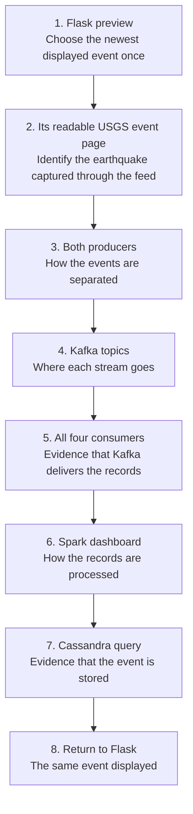

# Final project video script

Estimated speaking time: 2 to 3 minutes. Use conversational English and one continuous recording with the screens prepared in advance. Rehearse the screen changes once to check the total time.

Start with the finished earthquake page, choose its newest displayed event at Step 1, and follow that ID through the pipeline. Return to the page with evidence that the same event was stored and displayed. Keep the chosen ID throughout the recording even if newer earthquakes arrive. The instructions require the full source-to-Flask workflow, and the rubric also grades all four consumers. By our chosen recording scope, this video ends with the Flask result. Each member's contribution and learning will be covered in Luigi's report.

## Before recording

Work from `/mnt/d/Documents/ds2` in WSL. Use [the startup guide](../README.md) if Kafka, Cassandra, Spark, or Flask has stopped. Do not reformat Kafka storage or recreate the Cassandra volume. The prepared terminal layout is available with:

```bash
tmux attach -t ds2-finalproject-demo
```

Its eight windows are `producers` (two panes), `low-consumers` (two panes), `high-consumers` (two panes), `database` (cqlsh), `topics` (both Kafka topic descriptions), `website` (Flask server output), `kafka` (broker), and `spark` (streaming job). In tmux, press `Ctrl-b` then a window number from `1` through `8` to switch. If your tmux key bindings differ, run these from another shell:

```bash
tmux select-window -t ds2-finalproject-demo:producers
tmux select-window -t ds2-finalproject-demo:low-consumers
tmux select-window -t ds2-finalproject-demo:high-consumers
tmux select-window -t ds2-finalproject-demo:database
tmux select-window -t ds2-finalproject-demo:topics
tmux select-window -t ds2-finalproject-demo:website
tmux select-window -t ds2-finalproject-demo:kafka
tmux select-window -t ds2-finalproject-demo:spark
```

Keep this layout. Select window `1` before starting so it is ready when you switch from the browser to tmux. Windows `6` through `8` keep Flask, Kafka, and Spark running and help with troubleshooting. Show Flask and Spark in the browser during the demonstration. Start all services before recording.

### Which tmux windows to show

The recording-flow table below is your screen checklist. The bracketed cues in the narration tell you when to switch. You do not need to tour all eight windows or show the startup process.

| Window | Use during recording |
| :--- | :--- |
| `1`: `producers` | Show both panes at Step 3, with recent deliveries and the chosen event ID visible. |
| `2`: `low-consumers` | Show both consumers at Step 5, with their labels and matching IDs or offsets visible. |
| `3`: `high-consumers` | Show both consumers next at Step 5, with their labels and matching IDs or offsets visible. |
| `4`: `database` | Run the prepared CQL queries at Step 7 to show current records and the chosen event. |
| `5`: `topics` | Show both topic descriptions at Step 4. Rerun the commands below if either description has scrolled out of view. |
| `6`: `website` | Keep Flask running. Show its browser page at Steps 1 and 8. |
| `7`: `kafka` | Keep the broker running. Its startup logs do not need a separate screen segment. |
| `8`: `spark` | Keep the streaming job running. Show its browser dashboard at Step 6; use this window's batch logs only if helpful. |

The terminal components are prepared in tmux. Rehearse the browser changes and Cassandra query before recording. Choose the actual event at Step 1. Use the query helper below in a terminal outside the recorded window to prepare its CQL query.

### Rebuild terminals only if the session is missing

If the prepared tmux session no longer exists, create your own panes and run these six commands from the workspace root, one command per pane:

```bash
.venv/bin/python -u project/producer_low.py
.venv/bin/python -u project/producer_high.py
.venv/bin/python -u project/consumer.py low-1
.venv/bin/python -u project/consumer.py low-2
.venv/bin/python -u project/consumer.py high-1
.venv/bin/python -u project/consumer.py high-2
```

Use another pane for `docker exec -it ds2-finalproject-cassandra cqlsh`.

### Prepare the browser tabs

Open these browser tabs before recording:

1. [Flask page](http://127.0.0.1:5000/). Start here with the summary and the first rows visible.
2. The readable USGS event page. At Step 1, click **Details** on the first Flask row to open the earthquake you will follow. Its URL comes from that row, so no fixed event link is needed.
3. [Spark dashboard](http://localhost:4040/), then click **Structured Streaming**. Leave the active query visible. Check that recent batches have processed data before recording; input may be zero between producer polls.

### Prepare the USGS event for Step 2

Rehearse these actions before recording, then choose the actual event at Step 1. The single-event trace is our presentation choice; the instructions require showing the workflow but do not prescribe an event ID.

1. At Step 1, reload Flask and scroll the earthquake table to the top. The first row is the newest stored earthquake by occurrence time. Copy its **Event ID** and note the date in **Occurred (UTC)**. This is the event you will follow for the whole recording. Use the occurrence date, not **Last captured (UTC)** or today's local date.
2. Click **Details** on that same row to open its readable USGS event page for Step 2. A newer row arriving later does not change the event you selected.
3. Keep the event title and address bar visible. Show the magnitude, location, occurrence time, coordinates, and depth at a readable zoom level. Scroll briefly if needed. Point to the event ID at the end of the URL so the audience knows which record you will follow. Check the displayed time zone before comparing it with the consumers' UTC time. USGS can revise an event's values between captures, so compare the current pages before recording.
4. At the terminal steps, find that ID in its producer pane and its two consumer panes. Each producer sends its five latest matching events per poll; use tmux copy mode to find the selected ID if newer output has scrolled past it. Show both magnitude groups, but follow your chosen earthquake only through the group it belongs to. At Step 8, use browser Find to locate the same ID in Flask even if its row has moved down.

The readable USGS page is the main visual for Step 2. Explain that the producers capture the corresponding records through the [USGS GeoJSON feed](https://earthquake.usgs.gov/earthquakes/feed/v1.0/summary/all_day.geojson). They do not scrape the readable event page. Keep the feed link as a technical reference; showing raw JSON in the video is optional. The [USGS field definitions](https://earthquake.usgs.gov/earthquakes/feed/v1.0/geojson.php) explain the source fields.

### Keep the Spark dashboard running

Port `4040` belongs to the running Spark application. It becomes available when `stream.py` starts and closes when that application stops. The prepared session runs it in tmux window `8`, `spark`.

If it has stopped, ensure Kafka and Cassandra are running, then run this in the `spark` window. Do not launch another copy while the existing job is active:

```bash
cd /mnt/d/documents/ds2
export PYSPARK_PYTHON="$PWD/.venv/bin/python"
export PYSPARK_DRIVER_PYTHON="$PWD/.venv/bin/python"
"$SPARK_HOME/bin/spark-submit" --master 'local[1]' --conf spark.driver.memory=512m \
  --packages org.apache.spark:spark-sql-kafka-0-10_2.13:4.2.0 project/stream.py
```

Leave the job running, open <http://localhost:4040/>, and select **Structured Streaming**. Use `localhost` in your Windows browser; it passed the Windows connection check on this setup. Confirm that the terminal reports `Spark batch=... stored=... rows in Cassandra` and that the dashboard shows recent processing.

### Prepare Kafka and Cassandra evidence

The prepared `topics` window already shows Kafka's two topics. If you had to rebuild the session, run these in a spare terminal:

```bash
"$KAFKA_HOME/bin/kafka-topics.sh" --bootstrap-server localhost:9092 --describe --topic usgs-earthquakes-below-2-5
"$KAFKA_HOME/bin/kafka-topics.sh" --bootstrap-server localhost:9092 --describe --topic usgs-earthquakes-2-5-plus
```

If you want a raw JSON sample ready in the `topics` window, run either of these before recording. These commands read the earliest retained message, which may have a different ID from the recent event you follow in the demonstration:

```bash
"$KAFKA_HOME/bin/kafka-console-consumer.sh" --bootstrap-server localhost:9092 --topic usgs-earthquakes-below-2-5 --from-beginning --max-messages 1
"$KAFKA_HOME/bin/kafka-console-consumer.sh" --bootstrap-server localhost:9092 --topic usgs-earthquakes-2-5-plus --from-beginning --max-messages 1
```

At Step 7, run this overview query at the cqlsh prompt. It displays stored dates and IDs together with magnitudes and source topics. `LIMIT 20` does not select the newest earthquakes; this query is only an overview. Your selected event is the first Flask row you chose at Step 1:

```sql
SELECT event_day, event_id, magnitude, source_topic FROM finalproject.earthquakes_by_day LIMIT 20;
```

### Prepare the chosen event's query off screen

The helper is preparation, not another video step. After choosing your Step 1 ID, run this in a WSL shell outside the recorded window. It prompts for that ID, finds its stored UTC date, and prints a complete CQL query:

```bash
cd /mnt/d/documents/ds2
.venv/bin/python project/demo_query.py
```

Paste the ID you copied from Flask when prompted. Copy the generated `SELECT` statement and run it at the cqlsh prompt in tmux window `4` during Step 7, after the overview query. Show the CQL and its returned row in the video. You do not need to show the helper or narrate its operation.

If you record the whole desktop, prepare the query immediately before the take and confirm that Step 1 shows the same selected first row. If a newer first row appears before the take begins, select it and generate its query before restarting the take. During the recording, keep the chosen ID even when new rows arrive.

The helper only reads Cassandra. It searches today's and yesterday's UTC partitions, matching the Flask page's date range, and refuses to generate a query if the ID is absent. It does not automatically choose another event. No date or event ID is fixed in the helper or this procedure.

Keep the Step 1 ID throughout the recording. Do not choose a new "latest" ID at Step 7 or Step 8. In tmux, use copy mode to keep the chosen lines visible if the output scrolls. Use browser Find to locate the ID in Flask; the USGS event page's URL identifies the event.

Run the Cassandra queries during the demonstration, or rerun prepared queries from cqlsh history. Keep the matching row visible long enough to read. Counts and IDs can differ from the saved screenshots because the source is live. A later capture may update an existing event without increasing the row count.

Part 9 still requires each member's contribution and learning in the submission. We chose to cover these in the report and omit a contribution segment from the video. Marl covers the technical work and video; Luigi covers the report work. Each person's learning statement must reflect their actual experience. [The evidence handoff](evidence_handoff.md) contains verified facts and screenshots for Luigi's report.

## Recording flow

Follow this screen order. The narration below uses the same sequence.

| Step | Screen to show | What to show and explain |
| :--- | :--- | :--- |
| 1 | Browser: Flask, port `5000` | Reload and scroll to the top. Choose the first row, note its ID and UTC occurrence date, and click its **Details** link. Introduce what the project produces. |
| 2 | Browser: chosen USGS event page | Show magnitude, location, occurrence time, coordinates, and depth. Point to the ID in the URL. Explain that the producers capture the corresponding data through USGS's GeoJSON feed. |
| 3 | tmux `1`: `producers` | Show both producers' repeated deliveries. Explain the magnitude split and identify the chosen event ID. |
| 4 | tmux `5`: `topics` | Show the two topic names. Explain that Kafka keeps the two streams separate. A raw JSON sample is optional. |
| 5 | tmux `2`, then `3`: consumer pairs | Show all four consumer labels and their messages. Point out matching IDs or offsets within each pair as evidence of independent reads. |
| 6 | Browser: Spark, port `4040` | Show **Structured Streaming**, the running query, and recent batch metrics. Explain parsing and processing before storage. |
| 7 | tmux `4`: `database` | Query rows from both topics, then the chosen event. Show its ID, magnitude, location, and time. |
| 8 | Browser: Flask, port `5000` | Find the same event in the scrollable table. Show the capture time and explain how the page updates. |

The arrows below indicate presentation order. Spark and the four demonstration consumers each read directly from Kafka.



For browser-based terminal screenshots, the optional read-only ttyd view is:

```bash
ttyd -i 127.0.0.1 -p 7681 tmux attach-session -t ds2-finalproject-demo
```

Open <http://127.0.0.1:7681/> in a browser. The video can record tmux directly; ttyd is only a convenient browser view for screenshots. It is read-only unless `-W` is passed, so enter CQL in your tmux terminal rather than the browser view.

## Narration

Read the paragraphs aloud. The bracketed cues are actions to prepare or perform on screen. Let each closing sentence lead into the next screen, and pause briefly after switching so the audience can read the evidence.

[On screen: reload Flask and scroll to the first row. Point to its event ID and UTC occurrence time. Copy the ID and open that row's Details link for the next screen.]

This is our earthquake monitor. The summary shows the two magnitude groups, and the table lists recent earthquakes with their location and time. I'll follow the newest event shown here, keeping this same ID throughout the demonstration. Let's start with where its data comes from.

[On screen: the readable USGS event page. Show its magnitude, location, time, coordinates, and depth. Point to the event ID in the address bar.]

This USGS page shows the earthquake's magnitude, location, time, coordinates, and depth. Its event ID is at the end of the URL. Our producers capture the corresponding data through USGS's GeoJSON feed. I'll use this ID to track the same earthquake, beginning with the producers.

[On screen: tmux window 1, with both producer panes and their delivery messages visible.]

These two panes show our producers polling the feed every minute. One sends magnitudes below 2.5; the other sends 2.5 and above. Each delivery line identifies the topic, event ID, magnitude, and location. Here is the event I'm following. The producers send these records as JSON to two Kafka topics.

[On screen: tmux window 5, with both topic descriptions visible.]

These topic descriptions show where each producer sends its records: one topic for lower magnitudes and one for 2.5 and above. To check that the records actually arrived, I'll show the consumers reading them.

[On screen: tmux window 2. Point to both consumer labels and matching event IDs or offsets.]

Here, low-1 and low-2 both display records from the lower-magnitude topic, including the event IDs and offsets.

[On screen: tmux window 3. Show both high-consumer labels and matching messages.]

The high pair does the same for the other topic. Each consumer has its own group, so both consumers in a pair independently receive the same messages. Spark also reads these two topics to process the records.

[On screen: Spark's Structured Streaming tab, with the active query and recent batch metrics visible.]

This is Spark's Structured Streaming dashboard. The running query and recent batch metrics show processing activity. Spark parses the JSON into a streaming DataFrame, checks the required fields and magnitude groups, and writes valid records to Cassandra. I'll verify those writes in the database next.

[On screen: tmux window 4. Query rows from both topics, then query the chosen event by its UTC date and ID.]

The first query shows stored records from both topics. The second finds the earthquake I'm following, with the same ID, magnitude, location, and time. Later captures update its existing row. With the record stored, I'll return to Flask to show how it appears on the page.

[On screen: return to Flask, find the chosen event, and show its capture time. Scroll the table briefly.]

Back on our monitor, this row has the same event ID we followed from USGS through Kafka and Cassandra. Its capture time shows when our producer collected it. Flask reads the stored records from Cassandra and refreshes this scrollable table every 60 seconds as captures arrive.
