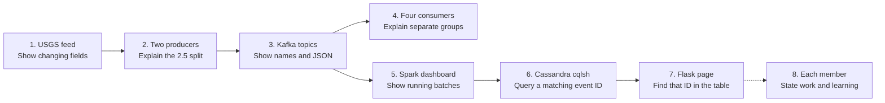

# Final project video script

Estimated speaking time: 2 to 3 minutes. Record the screen and voice yourself. The video should show the live USGS source, both producers and Kafka topics, all four rubric consumers, active Spark processing, stored Cassandra rows, the Flask result, and each member's contribution.

## Before recording

Work from `/mnt/d/Documents/ds2` in WSL. Use [the startup guide](../README.md) if Kafka, Cassandra, Spark, or Flask has stopped. Do not reformat Kafka storage or recreate the Cassandra volume. The prepared terminal layout is available with:

```bash
tmux attach -t ds2-finalproject-demo
```

Its six windows are `producers` (two panes), `low-consumers` (two panes), `high-consumers` (two panes), `database` (cqlsh), `topics` (both Kafka topic descriptions), and `website` (Flask server output). In tmux, press `Ctrl-b` then a window number from `1` through `6` to switch. If your tmux key bindings differ, run these from another shell:

```bash
tmux select-window -t ds2-finalproject-demo:producers
tmux select-window -t ds2-finalproject-demo:low-consumers
tmux select-window -t ds2-finalproject-demo:high-consumers
tmux select-window -t ds2-finalproject-demo:database
tmux select-window -t ds2-finalproject-demo:topics
tmux select-window -t ds2-finalproject-demo:website
```

If the prepared tmux session no longer exists, create your own panes and run these six commands from the workspace root, one command per pane:

```bash
.venv/bin/python -u project/producer_low.py
.venv/bin/python -u project/producer_high.py
.venv/bin/python -u project/consumer.py low-1
.venv/bin/python -u project/consumer.py low-2
.venv/bin/python -u project/consumer.py high-1
.venv/bin/python -u project/consumer.py high-2
```

Use another pane for `docker exec -it ds2-finalproject-cassandra cqlsh`. Open these browser tabs before recording:

1. [USGS live past-day GeoJSON](https://earthquake.usgs.gov/earthquakes/feed/v1.0/summary/all_day.geojson). Show the URL and a feature's `id`, `mag`, `place`, `time`, `updated`, and coordinates. The source feed refreshes each minute, so the exact records will change.
2. [Spark dashboard](http://127.0.0.1:4040/), then click **Structured Streaming**. Show the query status and batch/input metrics while the job runs.
3. [Flask page](http://127.0.0.1:5000/). The browser page refreshes every 15 seconds; you can reload it on camera.

The prepared `topics` window already shows Kafka's two topics. If you had to rebuild the session, run these in a spare terminal:

```bash
"$KAFKA_HOME/bin/kafka-topics.sh" --bootstrap-server localhost:9092 --describe --topic usgs-earthquakes-below-2-5
"$KAFKA_HOME/bin/kafka-topics.sh" --bootstrap-server localhost:9092 --describe --topic usgs-earthquakes-2-5-plus
```

To show a raw JSON message from either topic, use one command per topic. `--from-beginning` means these commands can finish immediately even between producer polls:

```bash
"$KAFKA_HOME/bin/kafka-console-consumer.sh" --bootstrap-server localhost:9092 --topic usgs-earthquakes-below-2-5 --from-beginning --max-messages 1
"$KAFKA_HOME/bin/kafka-console-consumer.sh" --bootstrap-server localhost:9092 --topic usgs-earthquakes-2-5-plus --from-beginning --max-messages 1
```

At the cqlsh prompt, run the following query. It displays IDs, magnitudes, and their source topics together. For a focused trace, copy one recent ID from a consumer, use its UTC event date, and run the second query with the real values:

```sql
SELECT event_id, magnitude, source_topic FROM finalproject.earthquakes_by_day LIMIT 20;
SELECT event_id, magnitude, place, occurred_at, source_topic FROM finalproject.earthquakes_by_day WHERE event_day = 'YYYY-MM-DD' AND event_id = 'EVENT_ID';
```

Check that the same recent ID appears in its producer pane, one of that topic's consumer panes, Cassandra, and the Flask table. Use browser Find on the Flask page if needed. The sample records and total row count may differ from the screenshots because the source is live. Show the real current values. Give every member a brief speaking segment, with their actual component or evidence on screen, stating what they did and what they learned. Each member should supply their own learning statement; Luigi will put those statements in his report. [The evidence handoff](evidence_handoff.md) contains verified facts and screenshots for him.

## Recording flow

Follow the numbered screen order below. Solid arrows show how the data moves; the four consumers read from Kafka alongside Spark. The dotted final arrow is a cue to finish with member contributions. At each screen, explain the point named inside its box.



For browser-based terminal screenshots, the optional read-only ttyd view is:

```bash
ttyd -i 127.0.0.1 -p 7681 tmux attach-session -t ds2-finalproject-demo
```

Open <http://127.0.0.1:7681/> in a browser. The video can record tmux directly; ttyd is only a convenient browser view for screenshots. It is read-only unless `-W` is passed, so enter CQL in your tmux terminal rather than the browser view.

## Narration

[On screen: USGS GeoJSON URL and one feature's fields.] I use the USGS past-day earthquake feed. It changes frequently and gives me an event ID, magnitude, location, time, last update, and coordinates. My two producers each poll this same source every minute.

[On screen: the two `producers` panes, the `topics` window, then a JSON message.] I split the events at magnitude 2.5. The left producer publishes lower magnitudes to `usgs-earthquakes-below-2-5`; the right publishes 2.5 and above to `usgs-earthquakes-2-5-plus`. Each message is JSON and includes the source fields plus when we captured it.

[On screen: both `low-consumers` panes, then both `high-consumers` panes.] These four consumers independently read the two topics. Each pair has separate Kafka consumer groups, so both screens in a pair receive messages from their assigned topic. I can use an event ID from here to follow one record through the pipeline.

[On screen: Spark **Structured Streaming** tab and, if useful, the Spark terminal batch log.] Spark reads both topics as a stream, parses the JSON fields, checks that each message belongs to the correct magnitude band, and writes the processed data to Cassandra. The running query and its batch metrics show active processing.

[On screen: cqlsh query with rows from both topics.] Cassandra stores each event under its UTC event day and ID. These rows show magnitudes and topic names from both producers. When a source event appears in a later poll, its row is updated.

[On screen: Flask page, reload, and scroll to the matching event ID.] Flask reads the Cassandra table and displays recent earthquakes in a scrollable page. This ID matches the Kafka and Cassandra record I just showed.

[On screen: each member's actual component or evidence, one member at a time.] Each member states in first person which component they worked on and one concrete thing they learned. Use their real details; this cue has no scripted claim until those details are supplied.
